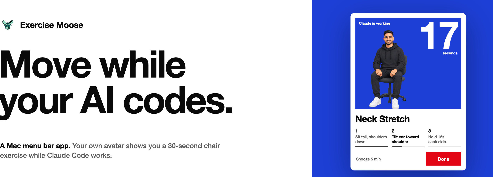
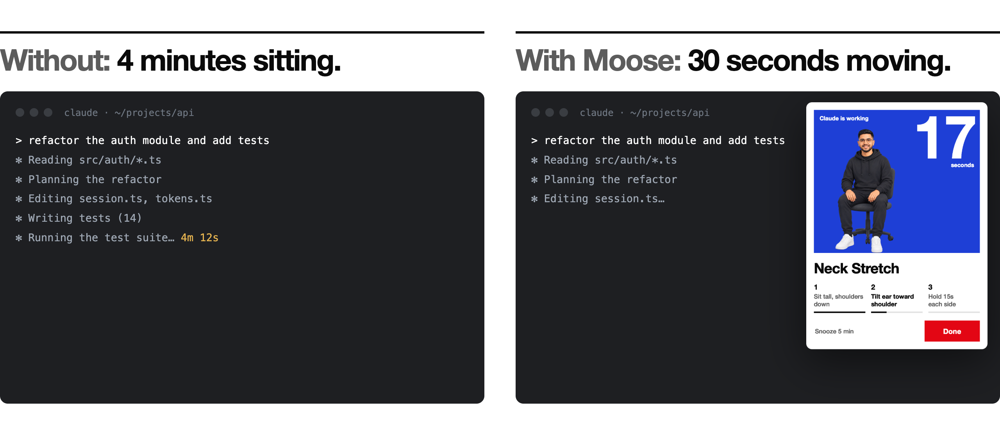
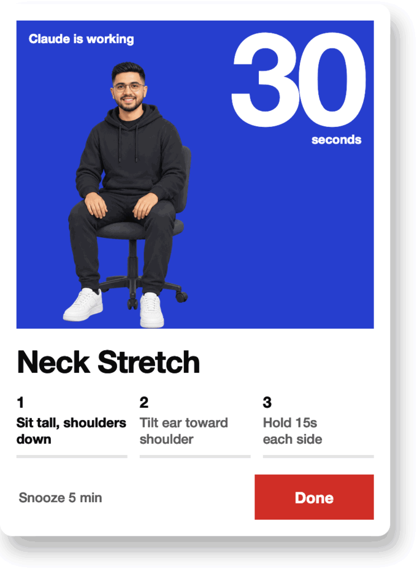

<p align="center">
  
</p>

<picture>
  <source media="(prefers-color-scheme: dark)" srcset="docs/readme/banner-dark.png">
  
</picture>

**Claude Code has been refactoring for four minutes. You have been watching the spinner.**
Exercise Moose turns that wait into a 30-second chair exercise, shown by your own avatar, and tells you
when Claude is done.

<picture>
  <source media="(prefers-color-scheme: dark)" srcset="docs/readme/before-after-dark.png">
  
</picture>

## Install in 3 steps

Needs **macOS 14 or later**, on Apple silicon or Intel. Free, MIT, native Swift. Nothing leaves your Mac.

### Step 1: Install the app

**Option A: Terminal (recommended).** Open Terminal and paste:

```bash
curl -fsSL https://raw.githubusercontent.com/harpreetkbadhan/exercise-moose/main/install.sh | bash
```

This downloads the latest release, checks its SHA-256 checksum (nothing is installed if it doesn't match),
puts **Exercise Moose** in Applications, adds the `moose` terminal command (it may ask for your password to
write `/usr/local/bin/moose`) and starts the app. No "unidentified developer" prompt this way.

**Option B: Download.**

1. Download `ExerciseMoose-x.y.zip` from the [latest release](https://github.com/harpreetkbadhan/exercise-moose/releases/latest).
2. Unzip it and drag **Exercise Moose** into Applications.
3. Open it once. macOS blocks the first launch because the app isn't signed with a paid Apple certificate:
   go to **System Settings → Privacy & Security** and click **Open Anyway**.

**Option C: Build from source.** Needs the Swift toolchain (`xcode-select --install`) and ffmpeg
(`brew install ffmpeg`).

```bash
git clone https://github.com/harpreetkbadhan/exercise-moose.git
cd exercise-moose
./build.sh
open "/Applications/Exercise Moose.app"
```

### Step 2: Find your moose in the menu bar

A small moose icon appears at the top right of your screen. Click it for the next break, your streak,
**Show now**, **Pause 1 hour** and **Settings**. Your first break comes after 30 minutes of work
(weekdays 9:00–18:00 by default); to see one right away, click **Show now** or run `moose break`.

It comes with a sample avatar (the author), so it works straight away. [Make your own](docs/avatar.md) any time.

### Step 3: Connect Claude Code (optional)

Open **Settings → AI agents**:

1. Click **Install hook** next to Claude Code. A break now appears when Claude works for more than a minute,
   and the card tells you when Claude is done.
2. Click **Install** next to Usage to see your context window and plan limits in the menu.

Both change only `~/.claude/settings.json`, back up your original first, and undo cleanly with **Remove**.
[What exactly they do](docs/claude-code.md).

### Handy terminal commands

```bash
moose status       # next break, streak and Claude Code usage
moose break        # show a break now
moose pause 30     # pause reminders for 30 minutes
moose resume       # turn reminders back on
moose quit         # quit the app
```

To uninstall, see [Privacy and help](docs/privacy.md#uninstall).

## One Claude task, three moments

<picture>
  <source media="(prefers-color-scheme: dark)" srcset="docs/readme/card-dark.gif">
  
</picture>

**1. Claude starts working.**
Send Claude Code a task. If it's still going after a minute, a card drops down from your menu bar:
*Claude is working*.

**2. You move for 30 seconds.**
Your avatar shows the exercise on its field. Three steps, the current one in bold, each bar filling as the
seconds count down.

**3. Claude is done.**
The card says so and leaves. Back to your terminal.

No agent running? It still works on its own: a break every 30 minutes, 12 seated exercises and a stand-up
break every 1–2 hours. [Connect Claude Code](docs/claude-code.md) with one button in Settings.

## Your limits, one click away

Click the moose in the menu bar. The next break and your streak sit on top; under them, Claude Code's
context window and its 5-hour and weekly plan limits, as bars.

<picture>
  <source media="(prefers-color-scheme: dark)" srcset="docs/readme/menu-dark.png">
  
</picture>

Limits at 80% or more get a warning. A nearly full context tells you it's time to `/compact`. When the
5-hour limit runs out, your avatar suggests a walk.

Turn it on with **Install** next to Usage in the menu (Settings → AI agents). The numbers come from Claude
Code's own status line data, your status line still looks exactly as before, and plan limits show on Pro and
Max plans. [How it works](docs/claude-code.md#usage-in-the-menu).

```console
$ moose status
Next break in 23 min
3-day streak, 4 of 6 today
Claude Code: Opus 5.5
   Context 68% of 1M
   5-hour limit 4%, resets 18:40
   Weekly limit 16%, resets Fri 14:00
```

## It stays out of your way

While your camera or mic is on, the break waits until the call ends, for up to 30 minutes. It only reminds
you between 9:00 and 18:00 on weekdays unless you change that, and a locked screen, sleep or 5 idle minutes
counts as a break.

The figure on the card is a person, not a mascot: the repo ships with the author as a sample avatar, and you
can [make your own](docs/avatar.md) from a photo with ChatGPT and Kling. It is Swift and AppKit, with no
Electron and no dependencies, about 7 MB with the sample avatar. No network calls, no accounts, no login tokens.

> [!IMPORTANT]
> **Health note:** Exercise Moose is a reminder tool, not medical advice. The exercises are gentle desk
> movements, but everyone's body is different. Move slowly, stay within a comfortable range and stop if
> anything hurts. If you have an injury, pain, a medical condition or are pregnant, ask a doctor or
> physiotherapist which exercises are right for you. The AI-generated videos can show imperfect form,
> so follow the written tips on each card. You use the app at your own risk.

## Docs

| Guide | What's in it |
|---|---|
| [Install](docs/install.md) | Terminal, download, or build from source |
| [Using Exercise Moose](docs/using.md) | The break card, the menu, Settings, the `moose` command |
| [Claude Code](docs/claude-code.md) | Agent breaks, usage in the menu, what the hook and status line do |
| [Make your own avatar](docs/avatar.md) | Prompts for your character and all 18 exercise videos |
| [Privacy and help](docs/privacy.md) | What stays on your Mac, uninstall, troubleshooting |
| [Development](docs/development.md) | Code map, tests, builds and releases |

## License

[MIT](LICENSE). The sample avatar images and videos in `raw/` show the author and are included for
demonstration; please use your own likeness in your builds.
