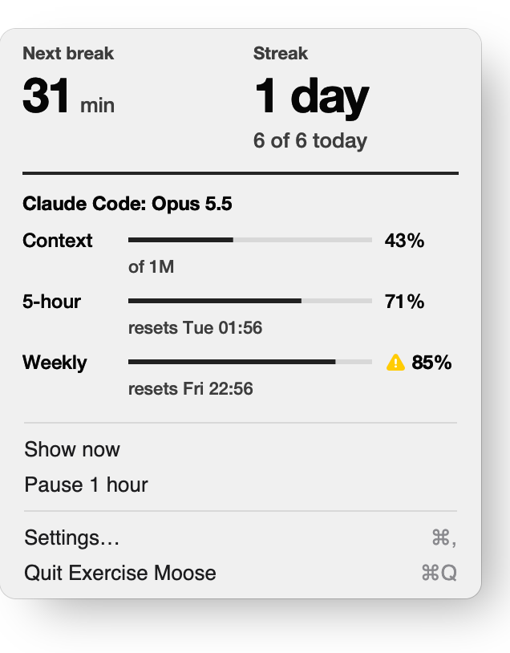

[Exercise Moose](../README.md) / Claude Code

# Move while your AI codes

Waiting on an AI agent is the perfect time to move. In **Settings → AI agents**, click **Install hook** next to
Claude Code. From then on:

1. You send Claude Code a task.
2. If it's still working after a minute, your avatar drops down with **"Claude is working"** and a quick seated exercise.
3. When Claude finishes (or needs your input), the popup shows **"Claude is done"** and closes.

At most one agent break every 15 minutes, never during calls, while you're away, while reminders are paused or
snoozed, or outside work hours.

**How it knows:** Claude Code runs official hooks (commands from your settings) on
`UserPromptSubmit`, `Stop`, `Notification` and `SessionEnd`. The button adds one command to those events in
`~/.claude/settings.json` (backing up your original to `settings.json.exercisemoose-backup` first):

```bash
'/Applications/Exercise Moose.app/Contents/MacOS/ExerciseMoose' --agent
```

That command reads only the event name and session id, sends a local start/stop signal to the app and prints
nothing. Your prompts and code never leave Claude Code. **Remove hook** takes it out again.

**Other tools and scripts** can send the same signals by hand:

```bash
'/Applications/Exercise Moose.app/Contents/MacOS/ExerciseMoose' --agent start --name Codex   # when the agent begins
'/Applications/Exercise Moose.app/Contents/MacOS/ExerciseMoose' --agent stop  --name Codex   # when it finishes
```

## Usage in the menu

Click **Install** next to **Usage in the menu** (Settings → AI agents) and the menu and `moose status` show
your context window and plan limits. Limits at 80% or more get a warning icon, a nearly full context suggests
`/compact`, and when the 5-hour limit runs out your avatar suggests a walk ("Claude limit reached"). Plan
limits appear for Pro and Max plans after the first reply in a session.

<picture>
  <source media="(prefers-color-scheme: dark)" srcset="readme/menu-dark.png">
  
</picture>

**How it knows:** these numbers come from Claude Code's official status line data. Claude Code allows one
status line command, so the button saves yours, swaps in `ExerciseMoose --statusline`, and that command
runs **your original status line with the same input** after copying the numbers to the app. Your status
line looks exactly as before. **Remove** puts the original back. No login tokens, no hidden APIs, nothing
leaves your Mac.

What the app changes in `~/.claude/settings.json`, and how it stays safe: [Privacy and help](privacy.md).
