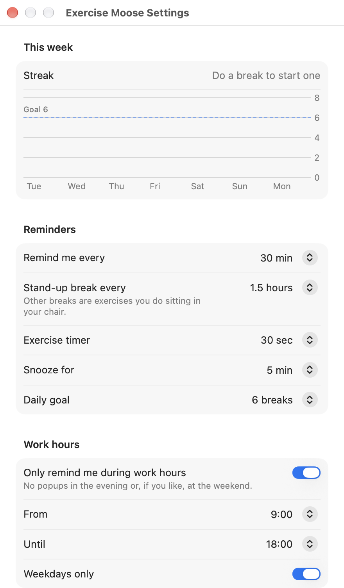

[Exercise Moose](../README.md) / Using Exercise Moose

# Using Exercise Moose

## The menu

Exercise Moose has no Dock icon. Your avatar's face sits in the menu bar; click it for the menu:

<picture>
  <source media="(prefers-color-scheme: dark)" srcset="readme/menu-dark.png">
  
</picture>

- **Next break** in minutes, and your **streak** with today's count against your daily goal.
- **Claude Code** context and plan limits as bars (once [connected](claude-code.md#usage-in-the-menu)).
- **Show now** for a break right away, **Pause 1 hour** (no popups at all, agent breaks included; the menu
  shows "Paused until …"), **Settings… (⌘,)** and **Quit**.

## The break card

Every 30 minutes a card drops down under the menu bar:

- The **field** shows your avatar doing the exercise. Its color shows the type: ultramarine for stretch,
  yellow for strength, green for moving around.
- The top of the field says **Seated** (do it in your chair) or **Stand up** (every 1–2 hours), and the type.
- The big number counts down the exercise time. Follow the three steps under the name: the current one is
  set in bold, and each step's bar fills in turn.
- Click **Done** to count it toward your streak (the card turns red and shows today's count), or
  **Snooze 5 min** (the card shows when the break comes back).

## Settings

Open the app again from Applications or Spotlight, or pick **Settings…** in the menu:

<p></p>

| Section | What you can set |
|---|---|
| **This week** | Your streak and a 7-day chart against your daily goal |
| **Reminders** | Break interval (15–90 min), stand-up break every 1 / 1.5 / 2 hours, exercise timer, snooze length, daily goal |
| **Work hours** | Only remind between, e.g., 9:00 and 18:00, weekdays only |
| **AI agents** | Exercise while Claude Code works, and show its usage in the menu |
| **Smart pause** | Wait until calls end; restart the timer after you've been away |
| **Popup** | Small / Medium / Large, and a test popup |
| **Exercises** | How many videos it found, and a button to open your exercises folder |
| **General** | Launch at login |

## Terminal commands

The `moose` command talks to the running app:

```bash
moose              # status, or start the app if it isn't running
moose status       # next break, streak and Claude Code usage
moose break        # show a break now
moose pause 30     # pause all reminders for 30 minutes (default 60, up to 1440)
moose resume       # turn reminders back on
moose start        # start the app
moose quit         # quit the app
moose help
```

```console
$ moose status
Next break in 23 min
3-day streak, 4 of 6 today
Claude Code: Opus 5.5
   Context 68% of 1M
   5-hour limit 4%, resets 18:40
   Weekly limit 16%, resets Fri 14:00
```

## Smart features

- **Work hours:** reminders only between 9:00 and 18:00 on weekdays by default. Outside those hours the
  menu shows "Off until Mon 9:00". Change or turn this off in **Settings → Work hours**.
- **Calls:** while your camera or microphone is in use (Zoom, Meet, Teams, FaceTime), the popup waits and
  appears right after the call, for up to 30 minutes.
- **Away:** a locked screen, sleep or 5 minutes without using your Mac counts as a break, so the timer starts fresh.
- **Streaks:** every **Done** counts. The menu shows your streak and today's count ("5 days, 4 of 6 today"),
  and Settings shows this week's chart.
- **Start at login:** turn on **Launch at login** in Settings.
- **Icons:** `./build.sh` turns your character into the app icon, and the menu bar shows your face.
  If the face crop looks off after changing your character, tune `FACE_CENTER_X`, `FACE_CENTER_FROM_TOP`
  and `FACE_SIZE` at the top of `Sources/ExerciseMoose/Face.swift`.
